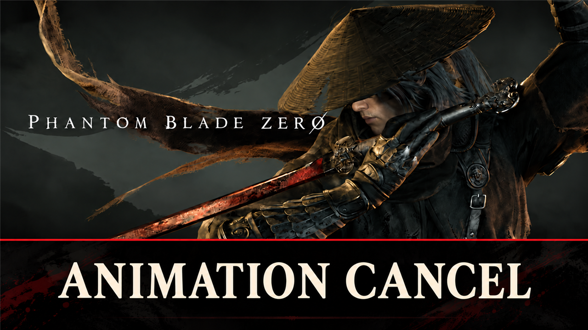

# Animation Cancel

Guard cuts your own attacks short, dodge where the game makes it wait, and dodge or guard breaks you out of a stagger. Settings in a text file next to the mod.

## What it does

Your guard no longer waits for your own swing to end, and dodge or guard gets you out of a stagger.

- **Guard cancel:** press guard during a light, heavy or weapon-switch attack, and you guard at once. In the game you
  wait for the swing to end.
- **Dodge:** the game itself already lets a dodge break most attacks; then the mod does nothing (it gives the game two
  frames and sees its dodge start). Only where the game refuses a dodge, the mod starts it, for example out of a
  guard.
- **Stagger escape:** while enemy hits keep you staggered, dodge rolls you out (the game's own escape roll) and guard
  raises your guard: after 0.4 s of stagger, at most once every 4 s. In the last part of a stagger, where the game
  already allows a dodge, it comes out at once.
- **Broken stance:** dodge also rolls you out of a broken stance (Sha-Chi broken).
- **Heal cancel** (off by default): a medicine key cuts an attack short too; the heal plays out in full.

Dodge and guard keep their costs, cooldowns and invincibility frames: the mod starts the game's own moves. Never
cancelled or escaped: combat arts, Sha-Chi skills, executions, perfect-dodge counters, a landed parry, a heal,
knockdowns, launches, being executed or grabbed, death and cutscenes. Nothing is written to your save.

| | Game | With the mod (default) |
|---|---|---|
| Guard during a light, heavy or weapon-switch attack | waits for the swing to end | at once |
| Dodge during an attack | mostly at once already | the same; the mod steps in only where the game refuses |
| Dodge during a guard | refused | at once |
| Dodge or guard in a standing stagger | waits | after 0.4 s, once every 4 s |
| Dodge in a broken stance | waits | rolls out |
| Medicine key during an attack | waits | waits (`CancelHeal=1`: drinks at once) |

It is a pak mod: it replaces one small game script and needs no UE4SS.

## Screenshots

## How to install

1. Download the zip of the latest release on GitHub (`phantombladezero_animationcancel_<version>.zip`).
2. Open the game folder `ProjectPBZ\Content\Paks\`. If it has no folder `~mods`, create it.
3. Unpack the four files of the zip into `ProjectPBZ\Content\Paks\~mods\`: the mod
   (`phantombladezero_animationcancel_P.pak`, `.utoc` and `.ucas`) and its settings file
   (`phantombladezero_animationcancel.txt`).
4. Start the game.

To update the mod, replace the three mod files with the ones of the new release; keep your settings file (a setting
that it does not have keeps its default). To remove the mod, delete the four files.

## How to use

Nothing to do: the mod works as soon as you load a game. Play as usual and press dodge or guard when you want out.

## Settings

The settings are in `ProjectPBZ\Content\Paks\~mods\phantombladezero_animationcancel.txt`, next to the mod. Open it
with a text editor, change a value and save: the mod reads the file every 2 seconds, so the game uses it without a
restart. Without the file the mod uses the defaults below. `on`/`off` and `true`/`false` work too; a value it cannot
read keeps its default.

| Setting | Default | What it does |
|---|---|---|
| `Cancel` | `1` | 1: guard cancels your normal attacks, dodge where the game refuses it; 0: as in the game |
| `CancelHeal` | `0` | 1: a medicine key cancels them too |
| `StaggerEscape` | `1` | 1: dodge or guard breaks out of a standing stagger |
| `EscapeBreak` | `1` | 1: dodge also rolls out of a broken stance |
| `EscapeDelayMs` | `400` | How long a stagger must last before an escape, 0 to 3000 ms |
| `EscapeCooldownS` | `4` | Seconds between two escapes, 0 to 60 |

## Compatibility

- Game version: Release (Steam build 26266538) (`CL-301524_JKS-17219`).
- The mod replaces the game script `ProjectPBZ/Content/JavaScript/UI/Widget/Foundation/WeaponAdvancdNumricEntry.js`
  (a small HUD script for weapon stat values; its own code stays as it is). A mod that replaces the same file
  conflicts with this one; only one of them works.
- Other mods that react to your dodge or parry (for example Witch Time, Heaven or Hell, Live by the Blade) work with
  it: a cancelled attack's dodge is the game's own dodge.
- After a game update that changes this script, the mod hides the update until a new version is out.

## Known issues

None yet.

## How to build

Anyone can build this mod from its source code and check that the download matches it.

1. Install the tools: Windows PowerShell 5.1 (part of Windows), [repak](https://github.com/trumank/repak/releases)
   v0.2.3 and [retoc](https://github.com/trumank/retoc/releases) v0.1.5 in a folder `_tools\repak\` and `_tools\retoc\`
   above the repository (or set `UE5_TOOLS`); optional: [Node.js](https://nodejs.org/) for the check of JavaScript.
   `README.md` has the details.
2. Build it: `powershell -ExecutionPolicy Bypass -File .\build.ps1`
3. Find the files: `dist\phantombladezero_animationcancel_P.pak`, `.utoc` and `.ucas`, and the settings file
   `dist\phantombladezero_animationcancel.txt`.

## Credits

Made by Kintaro. MIT license: you may use, change and share this mod. Phantom Blade Zero and its files belong to
their makers; the mod changes only what is listed above.
