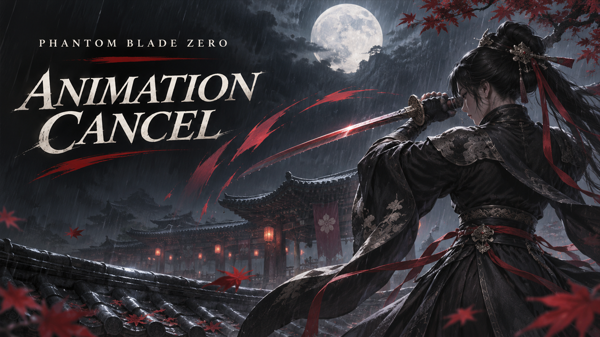

# Animation Cancel

Guard cuts your own attacks short, dodge where the game makes it wait, and dodge or guard breaks you out of a stagger. A PBZModLoader mod.

## What it does

Your guard no longer waits for your own swing to end, and dodge or guard gets you out of a stagger.

- **Guard cancel:** press guard during a light, heavy or weapon-switch attack, and you guard at once. In the game you
  wait for the swing to end.
- **Dodge:** the game itself already lets a dodge break most attacks; then the mod does nothing (it gives the game two
  frames and sees its dodge start). Only where the game refuses a dodge, the mod starts it, for example out of a
  guard.
- **Stagger escape:** while enemy hits keep you staggered, dodge rolls you out (the game's own escape roll) and guard
  raises your guard: after 0.4 s of stagger, at most once every 4 s. In the last part of a stagger, where the game
  already allows a dodge, it comes out at once.
- **Broken stance:** dodge also rolls you out of a broken stance (Sha-Chi broken).
- **Heal cancel** (off by default): a medicine key cuts an attack short too; the heal plays out in full.

Dodge and guard keep their costs, cooldowns and invincibility frames: the mod starts the game's own moves. Never
cancelled or escaped: combat arts, Sha-Chi skills, executions, perfect-dodge counters, a landed parry, a heal,
knockdowns, launches, being executed or grabbed, death and cutscenes.

| | Game | With the mod (default) |
|---|---|---|
| Guard during a light, heavy or weapon-switch attack | waits for the swing to end | at once |
| Dodge during an attack | mostly at once already | the same; the mod steps in only where the game refuses |
| Dodge during a guard | refused | at once |
| Dodge or guard in a standing stagger | waits | after 0.4 s, once every 4 s |
| Dodge in a broken stance | waits | rolls out |
| Medicine key during an attack | waits | waits (`CancelHeal=1`: drinks at once) |

It is a PBZModLoader mod: a script in the game's own script engine. It replaces no game file and writes nothing into
the save.

## Screenshots

## How to install

1. Install [PBZModLoader](https://github.com/KintaroModding/phantombladezero_pbzmodloader) 2.1.0 or later.
2. Download the zip of the latest release on GitHub (`phantombladezero_animationcancel_<version>.zip`).
3. Unpack it into the game folder (the folder that holds `ProjectPBZ`). It adds the folder
   `ProjectPBZ\PBZModLoader\mods\phantombladezero_animationcancel\` with `main.js` and the settings file.
4. Start the game.

To check that it runs: `ProjectPBZ\PBZModLoader\loader.log` has the line
`[PBZMOD] [Animation Cancel] <version> started; settings: ...`.

To update the mod, replace `main.js` with the one of the new release; keep your settings file (a setting that it does
not have keeps its default). To remove the mod, delete the folder `ProjectPBZ\PBZModLoader\mods\phantombladezero_animationcancel\`.

## How to use

Nothing to do: the mod works as soon as you load a game. Play as usual and press dodge or guard when you want out.

## Settings

The settings are in `ProjectPBZ\PBZModLoader\mods\phantombladezero_animationcancel\phantombladezero_animationcancel.txt`. Open it with a text editor,
change a value and save: the mod reads the file every 2 seconds, so the game uses it without a restart. Without the
file the mod writes it with the defaults below. Keys are not case-sensitive; `;` starts a comment. `on`/`off` and
`true`/`false` work too; a value it cannot read keeps its default.

**With Mods Menu** (0.9.0 or later) in the game, the mod adds its page to Mods Menu's tab in the game's settings, and
the page's settings are the ones that count: Mods Menu keeps them in its own file in the game's `Saved` folder, and
the file in the mod's folder is not read then.

| Setting | Default | What it does |
|---|---|---|
| `Cancel` | `1` | 1: guard cancels your normal attacks, dodge where the game refuses it; 0: as in the game |
| `CancelHeal` | `0` | 1: a medicine key cancels them too |
| `StaggerEscape` | `1` | 1: dodge or guard breaks out of a standing stagger |
| `EscapeBreak` | `1` | 1: dodge also rolls out of a broken stance |
| `EscapeDelayMs` | `400` | How long a stagger must last before an escape, 0 to 3000 ms |
| `EscapeCooldownS` | `4` | Seconds between two escapes, 0 to 60 |

## Compatibility

- Game version: Steam build 26367565 (`CL-302256_JKS-17280`).
- Needs PBZModLoader 2.1.0 or later. Mods Menu is optional.
- Version 1.0 of this mod (the files `phantombladezero_animationcancel_P.pak`, `.utoc`, `.ucas` and
  `phantombladezero_animationcancel.txt` in `ProjectPBZ\Content\Paks\~mods`): remove them first. 2.0 replaces no
  game script; copy your values into the new settings file.
- Other mods that react to your dodge or parry (for example Witch Time, Heaven or Hell, Live by the Blade) work with
  it: a cancelled attack's dodge is the game's own dodge.

## Known issues

- Not tested in game yet.

## How to build

There is nothing to build: `src\phantombladezero_animationcancel\` is the mod folder (`main.js` and the settings file).
`tests\test_mod.js` runs the script outside the game with Node.js and stand-ins for the game: `node tests\test_mod.js`.
`README.md` has the details.

## Credits

Made by Kintaro. MIT license: you may use, change and share this mod. PBZModLoader is made by LKF, its fork by
KintaroModding. Phantom Blade Zero and its files belong to their makers.
